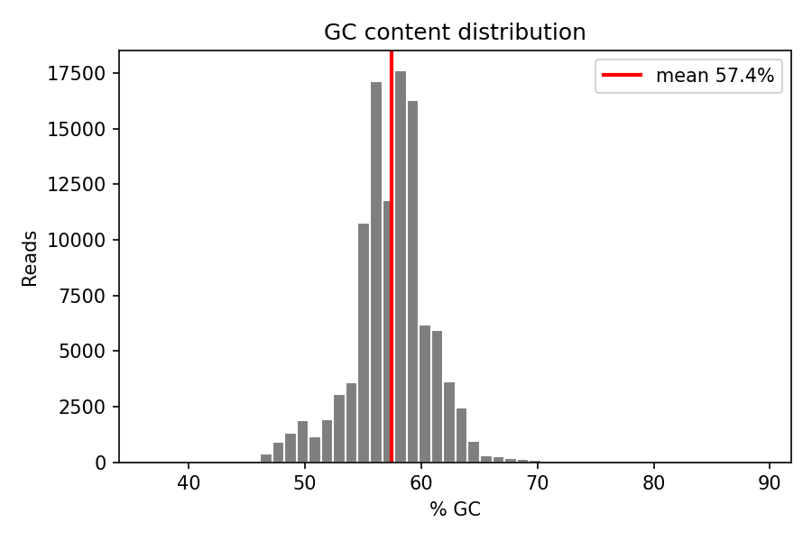

# Влияние загрязнения почвы керосином на состав бактериального сообщества

**Автор:** Иващенко Владимир Даниилович, Б06-303б  
**Логин:** `studfbmf01_19` @ `calc.cod.phystech.edu`  
**Стек:** Qiime2 2024.10.1 в Singularity-образе `qiime2-amplicon-2024.10.sif`  
**Мой прогон на Алдане:** SLURM job **119428** (partition `E5-2630-TITAN_X`), FINISHED 16.10.2026 23:18  
**Данные:** `/home/STUDY/FBMF/bioinformatics/metagenomes/soil_hw`, эксперимент PRJNA786393 (Albic Luvisols, pot)

Открыть `.qzv` на https://view.qiime2.org:

- `qzv/soil_reads.dada2.stats.qzv`
- `qzv/soil_taxonomy_barplot.qzv`
- `qzv/weighted_unifrac_emperor.qzv`
- `qzv/soil_shannon_significance.qzv`

---

## Задача 1. FastQC

Для QC выбрал контрольный образец ранней точки: **AL_k0_r1_d3_p_V4V5_C**, файл R1.

Результаты:

- 108 335 прочтений длиной 251 bp;
- средний Phred ≈ 35.8 (первые 25 nt ≈ 35.9, последние 50 ≈ 34.1);
- GC ≈ 57.4%; дубликаты ≈ 45%; N практически нет.

Качество Illumina-R1 хорошее по всей длине. На per-base content в первых ~25 позициях виден праймерный артефакт 515F — для 16S это ожидаемо. Значит, параметры denoising из задания (trim-left 25, trunc-len 200) адекватны.

---

## Задача 2. Смысл `--p-trim-left 25`

Trim-left удаляет 5′-хвост, где сидит праймер и возможны технические базы. Без этого:

- одинаковые праймерные основания попали бы в ASV и в классификацию;
- bias состава на старте рида искажал бы сравнение образцов.

В паре с `--p-trunc-len 200` все последовательности приводятся к одной полезной длине V4-фрагмента.

---

## Задача 3. DADA2 stats

Таблица из моего `soil_reads.dada2.stats.qzv`:

| Показатель | По прогону 119428 |
|---|---|
| % после filter | среднее **99.4** (min 97.93, max 99.88) |
| % non-chimeric | среднее **94.88** (min 89.4, max 97.08) |
| Наименьший non-chimeric | **4809** — `SRR17307380` |
| Наибольший non-chimeric | **43518** — `SRR17307475` |

Вывод: данные качественные — filter почти ничего не режет, химеры забирают лишь несколько процентов. Разброс глубины большой, поэтому rarefaction обязателен. Я задал `--p-sampling-depth 4568` (0.95 × min non-chimeric).

---

## Задача 4. Классификатор только на V4

Хотя праймеры 515F–907R закрывают V4–V5, в работе используются лишь прямые риды. После обрезки остаётся короткий фрагмент, стартующий с начала V4. Классификатор `2022.10.backbone.v4...qza` как раз обучен на V4 GreenGenes2 и совпадает с тем, что реально лежит в `soil_rep_seq.qza`. Для полного V4–V5 нужна была бы склейка пар, а R2 в задании не используют.

---

## Задача 5. Barplot

После упорядочивания по `level_and_time_point`:

**t1 (d3):** k0, k5 и k25 визуально сходны — сообщество ещё не успело ответить на керосин. Частые классы: Acidobacteriae, Alphaproteobacteria, Actinomycetia, Gammaproteobacteria.

**Динамика:** в загрязнённых образцах растёт доля Gammaproteobacteria; у k25 к d360 она становится подавляющей. Контроль сохраняет acidobacterial-профиль. При k5 к d360 виден частичный возврат к контролю.

**Level 6:** самый массовый род в загрязнении — **Paraburkholderia** (сем. Burkholderiaceae). Его всплеск при керосине биологически осмыслен: представители группы известны биодеградацией нефтепродуктов.

См. `qzv/soil_taxonomy_barplot.qzv`.

---

## Задача 6. β-разнообразие (weighted UniFrac)

Emperor-график показывает:

1. на первой временной точке все нагрузки образуют общий кластер;
2. дальше вдоль Axis 1 растёт расстояние k25 от k0, k5 занимает промежуток;
3. признаки восстановления есть после слабого загрязнения; после сильного — нет.

Это согласуется с barplot и Shannon.

Файл: `qzv/weighted_unifrac_emperor.qzv`.

---

## Задача 7. α-разнообразие (Shannon)

Средние значения из моего `shannon_vector` (rarefaction 4568):

| Нагрузка | d3 | d90 | d180 | d360 |
|---|---|---|---|---|
| k0 | 8.99 | 8.88 | 8.63 | 8.26 |
| k5 | 9.04 | 7.83 | 6.63 | 6.81 |
| k25 | 8.92 | 7.62 | 5.94 | **2.92** |

Интерпретация: контроль почти стабилен; k5 — просадка с частичным отскоком; k25 — глубокое и устойчивое обеднение сообщества.

Файл: `qzv/soil_shannon_significance.qzv`.

---

## Заключение

По результатам моего прогона на `studfbmf01_19` сильное загрязнение керосином (k25) приводит к доминированию *Paraburkholderia*/Gammaproteobacteria и падению Shannon примерно до 2.9 к d360 без восстановления. При k5 изменения мягче и к концу года частично обратимы.
